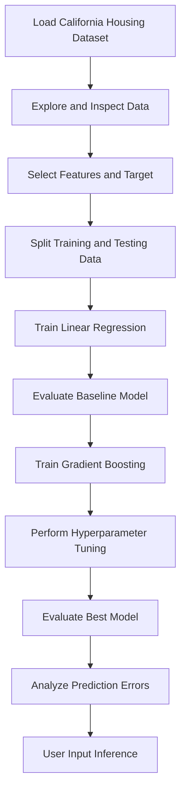

# 🏡 California Housing Price Prediction

<p align="center">
  
  
  
  
  
</p>

<p align="center">
  <strong>Predict California housing prices using machine learning regression.</strong>
  <br>
  A data science project exploring regression models, hyperparameter tuning, and price prediction.
</p>

---

## 📌 Overview

House price prediction is a regression task that estimates property values based on relevant housing and location features.

This project uses the **California Housing dataset** from Scikit-learn to build and evaluate machine learning regression models.

The project begins with **Linear Regression** as a baseline, then explores **HistGradientBoostingRegressor** to capture more complex relationships in the data. GridSearchCV is used to tune the Gradient Boosting model and improve its predictive performance.

The workflow covers data exploration, preprocessing, model training, evaluation, hyperparameter tuning, error analysis, and user-input inference.

## ✨ Key Features

- 📊 Exploratory Data Analysis (EDA).
- 🧹 Dataset inspection and missing-value checks.
- 🔀 Training and testing data split.
- 🤖 Linear Regression baseline model.
- 🌳 Gradient Boosting regression.
- 🔧 Hyperparameter tuning using GridSearchCV.
- 📈 Model evaluation using MAE, RMSE, and R².
- 🔍 Actual-versus-predicted comparison and error analysis.
- 💻 User-input inference for estimating house prices.

## 📂 Dataset

**Dataset:** California Housing

The dataset is loaded directly using Scikit-learn's `fetch_california_housing()` function.

| Property | Details |
|---|---|
| Total records | 20,640 |
| Input features | 8 |
| Target variable | Median house value |
| Training samples | 16,512 |
| Testing samples | 4,128 |
| Train-test split | 80:20 |

### Features Used

| Feature | Description |
|---|---|
| `MedInc` | Median income in the block group |
| `HouseAge` | Median house age |
| `AveRooms` | Average rooms per household |
| `AveBedrms` | Average bedrooms per household |
| `Population` | Block group population |
| `AveOccup` | Average household occupancy |
| `Latitude` | Geographic latitude |
| `Longitude` | Geographic longitude |

The target value is measured in units of **$100,000**. Values are capped near $500,000, which limits the model's ability to distinguish more expensive properties.

## ⚙️ Project Workflow



## 🧪 Algorithms Used

### 1. Linear Regression

Linear Regression is used as the baseline model. It estimates the relationship between input features and the target by fitting a linear function.

It provides a reference point for evaluating whether a more complex model improves prediction performance.

### 2. HistGradientBoostingRegressor

HistGradientBoostingRegressor is a tree-based ensemble regression algorithm that builds successive trees to improve predictions.

It can capture nonlinear relationships and interactions between housing features.

### 3. GridSearchCV

GridSearchCV searches through combinations of hyperparameters using cross-validation to identify a configuration with a better validation score.

The tuning process uses **negative mean absolute error** as the scoring metric.

Best parameters found:

```python
{
    "learning_rate": 0.05,
    "max_iter": 300,
    "max_leaf_nodes": 50,
    "l2_regularization": 0
}
```

## 📊 Model Evaluation

The models are evaluated using three regression metrics:

- **MAE (Mean Absolute Error):** Measures the average absolute prediction error.
- **RMSE (Root Mean Squared Error):** Penalizes larger prediction errors more heavily.
- **R² Score:** Measures how much variation in the target is explained by the model relative to a mean-prediction baseline.

### Performance Comparison

| Metric | Linear Regression | Tuned Gradient Boosting |
|---|---:|---:|
| MAE | 0.533 | 0.294 |
| RMSE | 0.746 | 0.449 |
| R² Score | 0.576 | 0.846 |

The tuned Gradient Boosting model performs better than the Linear Regression baseline on all three reported test metrics.

Its test-set R² score is approximately **0.8462**, with a lower MAE and RMSE. These are evaluation results, not a guarantee of accuracy for every individual house.

## 🛠️ Tech Stack

| Technology | Purpose |
|---|---|
| Python | Programming language |
| Pandas | Data manipulation and analysis |
| NumPy | Numerical operations |
| Matplotlib | Data visualization |
| Scikit-learn | Dataset loading, regression, tuning, and evaluation |
| Google Colab | Cloud-based notebook development |

## 📁 Repository Structure

```text
California-Housing-Price-Prediction/
│
├── california_houses.ipynb   # Complete ML workflow and inference
├── requirements.txt          # Python dependencies
└── README.md                 # Project documentation
```

## 🚀 Getting Started

### Prerequisites

- Python 3.x
- Google Colab or a local Jupyter environment
- Git (optional, for cloning the repository)

### 1. Clone the Repository

```bash
git clone https://github.com/tanush090/California-Housing-Price-Prediction.git
```

### 2. Navigate to the Project Directory

```bash
cd California-Housing-Price-Prediction
```

### 3. Install Dependencies

```bash
pip install -r requirements.txt
```

### 4. Run the Notebook

Start Jupyter Notebook:

```bash
jupyter notebook
```

Open `california_houses.ipynb` and run the cells in order.

Alternatively, open the notebook in Google Colab and execute the cells from top to bottom.

## 🔮 Future Improvements

- Compare additional regression algorithms.
- Explore feature engineering and feature importance.
- Use cross-validation to assess model stability.
- Improve prediction-error visualizations.
- Build an interactive web application for house price estimation.
- Investigate model limitations for high-value properties.

## 👨‍💻 Author

**Tanush Kumar**

B.Tech — Computer Science Engineering (AI & ML)

- GitHub: [@tanush090](https://github.com/tanush090)

---

<p align="center">
  <strong>Learning Machine Learning, One Project at a Time 🚀</strong>
</p>

*This project is for educational purposes. Predictions are estimates based on the dataset and should not be treated as actual property valuations.*
